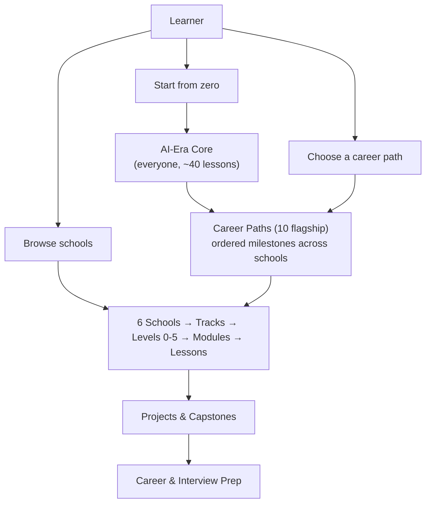

# Chaduvuko — Learning Architecture (AI-era master structure)

Status: **approved** (November 9, 2026). **Phase 1 implemented** on branch `phase-1-restructure` (not yet deployed); restore point is tag `v-before-phase1`. Later phases still need approval before they start.
Related: [PROJECT_MASTER_CONTEXT.md](./PROJECT_MASTER_CONTEXT.md) · [SITE_MAP.md](./SITE_MAP.md) (what exists today)

---

## 1. The problem this solves

Today a learner meets **four different ways** of organising the same content:

| Entry point | Count | Where |
|---|---:|---|
| Areas (Data, Cloud, AI & ML, …) | 7 | Tracks menu, `/learn` |
| Tracks (live + planned) | 55 (17 live, 1 hidden, 37 planned) | `lib/catalog/tracks.ts`, `data/planned-tracks.ts` |
| Role roadmaps | 20 | `/learn/roadmap` |
| "Find your path" goals | 7 | `/learn/find-your-path` |

They overlap but do not agree. Planned tracks sit next to live ones, so a beginner sees 55 options and cannot tell where to start. The two highest-priority tracks (Generative AI, Agentic AI) are still skills maps, while the largest live content is Data Engineering.

**Goal:** one map, three doors, and the same lesson experience everywhere.

---

## 2. The structure: one map, three layers

### Layer 1 — AI-Era Core (the common spine)

Every learner, regardless of goal, completes or tests out of this. It is what "modern AI era" means in practice: you can build, use data, and work with AI tools safely.

| Module | Outcome | Source today |
|---|---|---|
| C1. How computers, the internet and the cloud work | Explain a request from browser to server | `foundations`, `networking` (subset) |
| C2. Python fundamentals | Write and debug small programs | `python` Levels 0–1 |
| C3. Working like an engineer | Terminal, Git/GitHub, VS Code, reading docs | **new** (short) |
| C4. Data literacy and SQL basics | Query and reason about tables | `sql` Level 1 |
| C5. Math intuition for AI | Vectors, probability, gradients — intuition only | `ai-ml` math-foundations (subset) |
| C6. How AI and LLMs work | Tokens, embeddings, training vs inference, limits | `ai-ml` (subset) |
| C7. Working with AI tools | Prompting, verifying output, AI pair-programming, privacy, academic honesty | **new** |
| C8. First AI-powered project | Small app calling a model API, with evaluation | **new** (project) |

Rules: a **placement check** lets experienced learners skip modules; every module ends with a quiz and one hands-on task.

### Layer 2 — Six Schools (replaces the 7 areas)

Schools are the browsing structure. Each school shows **live tracks first**, and planned tracks only in a collapsed "Coming next" row.

| School | Live tracks now | Planned (priority order) |
|---|---|---|
| **School of AI** | AI & Machine Learning | Generative AI & LLM Engineering, Agentic AI & Automation, Mathematics for AI, Applied AI Specializations |
| **School of Data** | Data Engineering Foundations, Data Engineering, SQL, Apache Kafka, dbt, Snowflake | Data Analytics & Analytics Engineering, Database Engineering, Business Intelligence, Data Governance; Data Science *(hidden, return when complete)* |
| **School of Software Engineering** | Python, HTML & CSS | Full-Stack Development with AI, JavaScript & TypeScript, Java & Backend, Mobile, Software Testing, Accessibility, Additional languages |
| **School of Cloud & Platforms** | AWS, Microsoft Azure, Google Cloud | DevOps, Kubernetes & MLOps, SRE & Platform Engineering, Cloud Architecture & FinOps |
| **School of Security** | Cybersecurity | AI Security & LLM Security, Application Security & DevSecOps, Governance, Risk & Privacy |
| **School of Computer Science** | DSA, DBMS, Networking | System Design, Systems Programming, IT Support & SysAdmin, Networking & Telecom, specialist CS (compilers, HPC, hardware, physics) |

Specialist/niche tracks (game dev, XR, blockchain, robotics, embedded, enterprise platforms, DevRel, product management) move to a single **"Specialisations"** page per school so they stop crowding the main menu. They remain planned, not removed.

### Layer 3 — Career Paths (curated from the 20 roadmaps)

A path is an **ordered list of milestones across schools**, ending in a capstone and interview prep. It is what most learners should follow. Start with 10 flagship paths; the other roadmaps stay as reference pages.

| # | Career path | Milestones (in order) |
|---:|---|---|
| 1 | **AI Engineer (GenAI & LLM apps)** | Core → Python L2 → AI & ML basics → Generative AI → RAG & evaluation → deploy → capstone |
| 2 | **Agentic AI Engineer** | AI Engineer milestones 1–5 → Agentic AI → MCP, tools, multi-agent → guardrails & observability → capstone |
| 3 | **Machine Learning Engineer** | Core → Python → Math for AI → AI & ML → MLOps → capstone |
| 4 | **Data Engineer** | Core → SQL → DE Foundations → Data Engineering → Kafka/dbt/Snowflake → one cloud → capstone |
| 5 | **Data / Analytics Engineer & Analyst** | Core → SQL → Analytics Engineering → dbt → BI → capstone |
| 6 | **Full-Stack Developer (AI-enabled)** | Core → HTML & CSS → JavaScript/TypeScript → Full-Stack with AI → capstone |
| 7 | **Cloud & DevOps Engineer** | Core → Networking → one cloud → DevOps/Kubernetes → SRE basics → capstone |
| 8 | **Cybersecurity Analyst** | Core → Networking → Cybersecurity → AppSec → capstone |
| 9 | **AI Security Engineer** | Cybersecurity milestones → AI Security & LLM Security → red-teaming project |
| 10 | **Software Engineer (interview-ready)** | Core → Python → DSA → DBMS → System Design → mock interviews |

"Find your path" becomes the front door to these 10 paths: goal + level → recommended path + where to start (placement).

---

## 3. Inside every track: the same ladder

Unchanged from the master context, now applied consistently and shown visually on every track page:

**Level 0 Prerequisites → 1 Foundations → 2 Core Skills → 3 Advanced / Production → 4 Real-World Projects → 5 Career / Interview Prep**

Every track also has one **"AI in this field"** module (e.g. AI for data quality in Data Engineering, AI-assisted threat triage in Cybersecurity, AI coding workflows in Full-Stack). This is how "modern AI era" reaches every school, not only the School of AI.

---

## 4. Inside every lesson: one consistent, engaging anatomy

| Block | Purpose | Exists today? |
|---|---|---|
| 1. Hook — a real problem in 2–3 sentences | Why should I care? | Partly (varies by track) |
| 2. Objective + prerequisites + time | Know what you'll get | Yes (catalog metadata) |
| 3. Concept with diagram | Understand | Yes |
| 4. Hands-on: run it in the browser | Do | Yes for SQL/Python playgrounds; extend |
| 5. "Use AI here" box | How a professional uses AI for this task, and how to check its output | **New** |
| 6. Check yourself (3–5 questions) | Retrieval practice | Yes (`QuizSection`), extend coverage |
| 7. Mini-challenge | Apply without hints | Partly (`lesson-practice.ts`) |
| 8. Common mistakes / debugging | Production awareness | Partly |
| 9. Recap + "Up next" | Momentum | Yes (`up-next`, ContinueLearning) |

Targets: one objective per lesson; 8–15 min concept, 15–25 min demo, 15–30 min project.

---

## 5. Engagement system

Built on what already exists (`lib/progress.ts`, dashboard streaks/badges/goals/milestones, `learner-sync`, quizzes, playgrounds, ChatBot tutor):

| Mechanism | Status | Next step |
|---|---|---|
| Progress, resume, "Continue learning" | Live | Show path-level % on home page for returning learners |
| Streaks, weekly goals, badges | Live | Tie badges to milestones (e.g. "Core complete", "First RAG app") rather than raw counts |
| Quizzes and playgrounds | Live (partial coverage) | Every lesson gets a quiz; mark quiz pass as mastery |
| Project milestones | Live | Every path ends in a capstone with a public portfolio page |
| AI tutor | Live (ChatBot) | Make it lesson-aware (current lesson context, Socratic hints, no answer dumping) |
| Placement check | **New** | Skip Core modules learners already know |
| Spaced review | **New** | "Review 5 questions from last week" card on the dashboard |
| Path certificate of completion | **New** | Issued after capstone review; describe as completion, not accreditation |
| Weekly challenges / leaderboard | **New, optional** | Opt-in only; no public ranking by default |
| Community (comments, discussions) | Partial (CommentSection) | Per-lesson Q&A once traffic justifies moderation |

Measure success by completion and return rate, not page views: Core completion %, path milestone completion %, 7-day and 30-day return, quiz pass rate, capstones submitted.

---

## 6. Navigation (what learners actually see)

- **Home:** three doors — *Start from zero* (Core), *Choose a career path*, *Browse schools* — plus "Continue where you left off" for returning learners.
- **Header "Learn" menu:** Paths · Schools · Practice · Roadmaps. Planned tracks are not listed in the menu.
- **School page:** live tracks as cards with level ladder and lesson count; "Coming next" collapsed.
- **Path page:** milestone timeline, progress, estimated hours, capstone, "Start / Resume".
- **`/learn/all-courses`:** stays as the complete A–Z map for people who want everything.

---

## 7. Rollout (each phase needs approval)

| Phase | Scope | Content work |
|---|---|---|
| **1. Re-organise (no new lessons)** | Add `school` to tracks (6 schools); school pages; 10 career-path pages built from existing roadmaps; home "three doors"; menu shows live tracks only; Find-your-path recommends a path | None — uses existing 490 lessons |
| **2. AI-Era Core** | Assemble Core from existing lessons; write the 3 new modules (C3, C7, C8); placement check | ~10–15 new lessons |
| **3. Flagship AI tracks** | Generative AI & LLM Engineering, then Agentic AI & Automation (Levels 0–5, projects) | Largest effort; follows instructor hiring plan |
| **4. Engagement upgrades** | Lesson anatomy blocks ("Use AI here"), quiz coverage, spaced review, lesson-aware tutor, capstones + certificates | Incremental per track |
| **5. Next priority tracks** | Full-Stack with AI, DevOps/MLOps, AI Security, JavaScript/TypeScript, System Design | Per priority list |
| **6. Specialisations** | Remaining planned tracks as demand shows | As demand dictates |

Phase 1 as built:
- Schools: `lib/catalog/schools.ts` maps the six existing track areas to schools, so no track changed area. Pages: `/learn/schools` and `/learn/schools/[slug]`.
- Career paths: `data/career-paths.ts` (10 paths), resolved against live lessons by `lib/catalog/paths.ts`. Pages: `/learn/paths` and `/learn/paths/[slug]`, with browser-saved progress and Start/Resume. Steps whose track has no live lessons show as "coming soon" and link to the skills map.
- `validate-catalog` fails the build if a path references an unknown track or a module with no live lessons.
- Home "three doors" (Find your path, Career paths, Schools) and featured career paths; Courses menu, footer, learn hub, all-courses, and search link to paths and schools; menu headings use school names and link to school pages; Find your path recommends a career path.

Rules carried over: keep existing URLs working (redirect if anything moves); never count planned skills as lessons; approve a track's full curriculum before writing or recording; hide rather than delete thin tracks.

---

## 8. Open decisions for the owner

1. Approve the six school names and track placement above.
2. Approve the 10 flagship career paths (add/remove any).
3. Confirm Core is recommended but skippable (placement check), not mandatory.
4. Certificates: free completion certificates, or reserve for a paid tier (see Pipeline Prep Free/Pro model)?
5. ~~Phase 1 start~~ — approved and implemented November 9, 2026.
