# Chaduvuko site map

> Generated by `scripts/site-inventory.ts` on 2026-11-10. Do not edit by hand: run `npm run build` (or `npx next build`), then `npx tsx scripts/site-inventory.ts`.
> The public version of this map is [/learn/all-courses](https://chaduvuko.com/learn/all-courses). Page-level data is in [SITE_INVENTORY.csv](./SITE_INVENTORY.csv).

## How the site is organised

**School → Track → Module → Lesson.** A *school* groups related tracks (School of AI, School of Data, ...) at `/learn/schools/[slug]`. *Career paths* cut across schools in job order. A *track* is a guided course with its own overview page. A *module* is a section inside a track, and a *lesson* is one page with one learning objective.

| What | Count | Where it comes from |
|---|---:|---|
| Published tracks | 22 (+ Projects) | `lib/catalog/tracks.ts` |
| Published lessons | 685 | `lib/catalog` (`LIVE_LESSONS`) |
| Hidden tracks / lessons | 1 / 3 | `hidden` flag in `lib/catalog/tracks.ts` |
| Unpublished (`soon`) lessons | 50 | `data/*-curriculum.ts` |
| Planned tracks (skills maps) | 2 | `data/planned-tracks.ts` |
| Schools | 6 | `lib/catalog/schools.ts` |
| Career paths | 22 | `data/career-paths.ts` |
| Career roadmaps | 20 | `data/roadmaps/role-registry.ts` |
| Blog articles | 31 | `data/blog-articles.ts` |
| Open careers roles | 1 | `data/careers.ts` |

## Map

```mermaid
flowchart LR
  root(["Chaduvuko"])
  root --> area_ai["School of AI"]
  area_ai --> t_ai_ml["AI and Machine Learning<br/>90 lessons"]
  area_ai --> t_generative_ai["Generative AI and LLM Engineering<br/>16 lessons"]
  area_ai --> t_agentic_ai["Agentic AI and Automation<br/>14 lessons"]
  root --> area_data["School of Data"]
  area_data --> t_data_engineering["Data Engineering<br/>57 lessons"]
  area_data --> t_sql["SQL<br/>67 lessons"]
  area_data --> t_apache_kafka["Apache Kafka<br/>26 lessons"]
  area_data --> t_dbt["dbt<br/>23 lessons"]
  area_data --> t_snowflake["Snowflake<br/>22 lessons"]
  area_data --> t_analytics_engineering_data_analytics["Data Analytics and Statistics<br/>16 lessons"]
  root --> area_programming["School of Software Engineering"]
  area_programming --> t_python["Python<br/>50 lessons"]
  area_programming --> t_html_css["HTML and CSS<br/>45 lessons"]
  area_programming --> t_javascript["JavaScript and TypeScript<br/>14 lessons"]
  area_programming --> t_full_stack_ai["Full-Stack Development with AI<br/>15 lessons"]
  root --> area_cloud["School of Cloud and Platforms"]
  area_cloud --> t_cloud_data["Cloud Data Platforms<br/>27 lessons"]
  area_cloud --> t_devops_mlops["DevOps and Cloud Infrastructure<br/>16 lessons"]
  area_cloud -.-> p_cloud["1 planned tracks"]:::planned
  root --> area_security["School of Security"]
  area_security --> t_cybersecurity["Cybersecurity<br/>46 lessons"]
  area_security --> t_ai_security["AI Security and LLM Security<br/>10 lessons"]
  area_security -.-> p_security["1 planned tracks"]:::planned
  root --> area_cs["School of Computer Science"]
  area_cs --> t_dsa["Data Structures and Algorithms<br/>28 lessons"]
  area_cs --> t_dbms["DBMS<br/>22 lessons"]
  area_cs --> t_networking["Networking<br/>49 lessons"]
  area_cs --> t_operating_systems["Operating Systems<br/>11 lessons"]
  area_cs --> t_system_design["System Design<br/>15 lessons"]
  root --> area_practice["Practice"]
  area_practice --> t_projects["Cloud Data Projects<br/>6 lessons"]
  root --> practice["Practice and tools<br/>roadmaps, playgrounds, interview prep, blog"]
  root -.-> h_data_science["Data Science (hidden)"]:::hidden
  classDef planned fill:#f3e8ff,stroke:#a855f7,color:#3b0764
  classDef hidden fill:#f1f5f9,stroke:#94a3b8,color:#475569,stroke-dasharray: 4 3
```

## Career paths

Ordered routes across schools, at `/learn/paths/[slug]`. Planned steps link to a skills map until their lessons are published.

| Path | School | Steps | Planned steps | Live lessons |
|---|---|---:|---:|---:|
| [AI Engineer](https://chaduvuko.com/learn/paths/ai-engineer) | School of AI | 8 | 0 | 164 |
| [Agentic AI Engineer](https://chaduvuko.com/learn/paths/agentic-ai-engineer) | School of AI | 7 | 0 | 95 |
| [Machine Learning Engineer](https://chaduvuko.com/learn/paths/ml-engineer) | School of AI | 8 | 0 | 170 |
| [Data Engineer](https://chaduvuko.com/learn/paths/data-engineer) | School of Data | 10 | 0 | 239 |
| [Analytics Engineer & Data Analyst](https://chaduvuko.com/learn/paths/analytics-engineer) | School of Data | 9 | 0 | 155 |
| [Full-Stack Developer (AI-enabled)](https://chaduvuko.com/learn/paths/full-stack-ai-developer) | School of Software Engineering | 7 | 0 | 116 |
| [Cloud & DevOps Engineer](https://chaduvuko.com/learn/paths/cloud-devops-engineer) | School of Cloud & Platforms | 8 | 1 | 91 |
| [Cybersecurity Analyst](https://chaduvuko.com/learn/paths/cybersecurity-analyst) | School of Security | 6 | 1 | 91 |
| [AI Security Engineer](https://chaduvuko.com/learn/paths/ai-security-engineer) | School of Security | 7 | 1 | 75 |
| [Software Engineer (interview-ready)](https://chaduvuko.com/learn/paths/software-engineer) | School of Computer Science | 8 | 0 | 204 |
| [Generative AI Developer](https://chaduvuko.com/learn/paths/generative-ai-developer) | School of AI | 6 | 0 | 74 |
| [Data Scientist](https://chaduvuko.com/learn/paths/data-scientist) | School of AI | 7 | 0 | 144 |
| [MLOps Engineer](https://chaduvuko.com/learn/paths/mlops-engineer) | School of AI | 6 | 0 | 118 |
| [Data Analyst](https://chaduvuko.com/learn/paths/data-analyst) | School of Data | 6 | 0 | 80 |
| [Cloud Data Engineer](https://chaduvuko.com/learn/paths/cloud-data-engineer) | School of Data | 7 | 0 | 179 |
| [Database Engineer](https://chaduvuko.com/learn/paths/database-engineer) | School of Data | 6 | 0 | 112 |
| [Python Developer](https://chaduvuko.com/learn/paths/python-developer) | School of Software Engineering | 6 | 0 | 94 |
| [Frontend Developer](https://chaduvuko.com/learn/paths/frontend-developer) | School of Software Engineering | 6 | 0 | 69 |
| [Backend Developer](https://chaduvuko.com/learn/paths/backend-developer) | School of Software Engineering | 7 | 0 | 141 |
| [Site Reliability / Platform Engineer](https://chaduvuko.com/learn/paths/site-reliability-engineer) | School of Cloud & Platforms | 6 | 1 | 110 |
| [Cloud Security Engineer](https://chaduvuko.com/learn/paths/cloud-security-engineer) | School of Security | 7 | 1 | 104 |
| [Network Engineer](https://chaduvuko.com/learn/paths/network-engineer) | School of Computer Science | 6 | 0 | 57 |

## Published tracks

| School | Track | Overview | Modules | Lessons | Avg words / lesson |
|---|---|---|---:|---:|---:|
| School of AI | AI & Machine Learning | `/learn/ai-ml` | 15 | 90 | 0 |
| School of AI | Generative AI & LLM Engineering | `/learn/generative-ai` | 5 | 16 | 0 |
| School of AI | Agentic AI & Automation | `/learn/agentic-ai` | 3 | 14 | 0 |
| School of Data | Data Engineering | `/learn/data-engineering` | 7 | 57 | 0 |
| School of Data | SQL | `/learn/sql` | 14 | 67 | 0 |
| School of Data | Apache Kafka | `/learn/apache-kafka` | 5 | 26 | 0 |
| School of Data | dbt | `/learn/dbt` | 4 | 23 | 0 |
| School of Data | Snowflake | `/learn/snowflake` | 5 | 22 | 0 |
| School of Data | Data Analytics & Statistics | `/learn/analytics-engineering-data-analytics` | 5 | 16 | 0 |
| School of Software Engineering | Python | `/learn/python` | 6 | 50 | 0 |
| School of Software Engineering | HTML & CSS | `/learn/html-css` | 6 | 45 | 0 |
| School of Software Engineering | JavaScript & TypeScript | `/learn/javascript` | 3 | 14 | 0 |
| School of Software Engineering | Full-Stack Development with AI | `/learn/full-stack-ai` | 4 | 15 | 0 |
| School of Cloud & Platforms | Cloud Data Platforms | `/learn/cloud-data` | 7 | 27 | 0 |
| School of Cloud & Platforms | DevOps & Cloud Infrastructure | `/learn/devops-mlops` | 5 | 16 | 0 |
| School of Security | Cybersecurity | `/learn/cybersecurity` | 6 | 46 | 0 |
| School of Security | AI Security & LLM Security | `/learn/ai-security` | 3 | 10 | 0 |
| School of Computer Science | Data Structures & Algorithms | `/learn/dsa` | 5 | 28 | 0 |
| School of Computer Science | DBMS | `/learn/dbms` | 5 | 22 | 0 |
| School of Computer Science | Networking | `/learn/networking` | 9 | 49 | 0 |
| School of Computer Science | Operating Systems | `/learn/operating-systems` | 3 | 11 | 0 |
| School of Computer Science | System Design | `/learn/system-design` | 4 | 15 | 0 |
| Practice | Cloud Data Projects | `/learn/projects` | 1 | 6 | 0 |

### Modules in each track

<strong>AI & Machine Learning</strong> — 15 modules

- Introduction — 2 lessons
- Math Foundations — 7 lessons
- Programming Ecosystem — 5 lessons
- Data Engineering for ML — 6 lessons
- Classical Machine Learning — 18 lessons
- Evaluation and Optimisation — 8 lessons
- Deep Learning — 10 lessons
- Computer Vision — 5 lessons
- Natural Language Processing — 2 lessons
- Large Language Models — 4 lessons
- LLM Applications — Prompting, RAG and Agents — 4 lessons
- Fine-Tuning and Multimodal Models — 3 lessons
- Generative Models for Images — 3 lessons
- MLOps and Production — 8 lessons
- Cloud ML Platforms — 5 lessons

<strong>Generative AI & LLM Engineering</strong> — 5 modules

- Building with LLM APIs — 5 lessons
- Retrieval & Vector Databases — 2 lessons
- Quality, Safety & Operations — 4 lessons
- Shipping LLM Features — 3 lessons
- Capstone & Career — 2 lessons

<strong>Agentic AI & Automation</strong> — 3 modules

- Agent Foundations — 3 lessons
- Orchestration — 6 lessons
- Production Agents — 5 lessons

<strong>Data Engineering</strong> — 7 modules

- What Even Is This? — 6 lessons
- Data Fundamentals — 7 lessons
- Core Engineering Skills — 7 lessons
- How Data Moves — 12 lessons
- Storage & Architecture — 8 lessons
- Quality, Governance & Production — 10 lessons
- Spark, Airflow & Lakehouse Tables — 7 lessons

<strong>SQL</strong> — 14 modules

- Databases & Setup — 4 lessons
- Reading Data — SELECT — 10 lessons
- Filtering & Logic — 3 lessons
- Writing & Changing Data — 5 lessons
- Database Design — 4 lessons
- Aggregation — 3 lessons
- Joins — 6 lessons
- Subqueries & Set Operations — 5 lessons
- SQL Functions — 4 lessons
- Advanced SQL Objects — 7 lessons
- Window Functions & CTEs — 6 lessons
- Advanced SQL Patterns — 4 lessons
- Performance & Optimization — 3 lessons
- Real-World & Interview — 3 lessons

<strong>Apache Kafka</strong> — 5 modules

- Kafka From Zero — 4 lessons
- Core Kafka Mechanics — 5 lessons
- Building Kafka Applications — 6 lessons
- Operations, Security, and Scale — 6 lessons
- Architecture and Real-World Practice — 5 lessons

<strong>dbt</strong> — 4 modules

- dbt Foundations — 5 lessons
- Core dbt Development — 5 lessons
- Intermediate dbt — 5 lessons
- Production and Advanced dbt — 8 lessons

<strong>Snowflake</strong> — 5 modules

- Snowflake Foundations — 4 lessons
- Loading and Transforming Data — 4 lessons
- Snowflake Platform Features — 4 lessons
- Performance, Cost, and Governance — 4 lessons
- Production and Career Readiness — 6 lessons

<strong>Data Analytics & Statistics</strong> — 5 modules

- Analyst Toolkit — 4 lessons
- Statistics for Data — 4 lessons
- Metrics & Experiments — 3 lessons
- BI & Storytelling — 3 lessons
- Case Studies & Career — 2 lessons

<strong>Python</strong> — 6 modules

- Python Foundations — 10 lessons
- Core Data Structures & Logic — 9 lessons
- Object-Oriented Python — 7 lessons
- Intermediate & Functional Python — 7 lessons
- Advanced Python — 8 lessons
- Production & Career Readiness — 9 lessons

<strong>HTML & CSS</strong> — 6 modules

- HTML Foundations — 10 lessons
- HTML Deep Dive — 6 lessons
- CSS Foundations — 6 lessons
- CSS Layout — 7 lessons
- Advanced CSS — 9 lessons
- Production & Career Readiness — 7 lessons

<strong>JavaScript & TypeScript</strong> — 3 modules

- JavaScript Foundations — 8 lessons
- Modern JavaScript — 5 lessons
- Projects & Interview — 1 lesson

<strong>Full-Stack Development with AI</strong> — 4 modules

- Front End with React — 5 lessons
- Back End & Data — 5 lessons
- AI Features & Deployment — 3 lessons
- Capstone & Career — 2 lessons

<strong>Cloud Data Platforms</strong> — 7 modules

- Course Introduction — 1 lesson
- AWS — 9 lessons
- Microsoft Azure — 8 lessons
- Google Cloud — 6 lessons
- Platform-neutral Tools — 1 lesson
- Cross-cloud Foundations — 1 lesson
- Career Preparation — 1 lesson

<strong>DevOps & Cloud Infrastructure</strong> — 5 modules

- Developer Essentials — 3 lessons
- Containers — 2 lessons
- Cloud Infrastructure — 4 lessons
- Delivery & Operations — 5 lessons
- Capstone & Career — 2 lessons

<strong>Cybersecurity</strong> — 6 modules

- What Even Is This? — 6 lessons
- How Attacks Work — 7 lessons
- Core Technical Skills — 7 lessons
- Offensive Security — 7 lessons
- Defensive Security — 13 lessons
- Career & Production — 6 lessons

<strong>AI Security & LLM Security</strong> — 3 modules

- Threats to AI Systems — 3 lessons
- Securing AI Applications — 4 lessons
- Testing, Monitoring & Governance — 3 lessons

<strong>Data Structures & Algorithms</strong> — 5 modules

- Foundations — 8 lessons
- Linear Structures — 4 lessons
- Non-Linear Structures — 7 lessons
- Algorithm Paradigms — 8 lessons
- Interview — 1 lesson

<strong>DBMS</strong> — 5 modules

- Foundations — 4 lessons
- Design & SQL — 4 lessons
- Internals — 5 lessons
- Advanced Theory — 4 lessons
- Distributed & Interview — 5 lessons

<strong>Networking</strong> — 9 modules

- How Networks Work — 6 lessons
- Physical and Data Link Layer — 6 lessons
- The IP Layer — Addressing and Routing — 7 lessons
- Transport Layer — 5 lessons
- Application Layer Protocols — 8 lessons
- Network Security — 7 lessons
- Tools and Troubleshooting — 5 lessons
- Modern Network Architecture — 4 lessons
- Career and Interview Preparation — 1 lesson

<strong>Operating Systems</strong> — 3 modules

- Processes & Concurrency — 5 lessons
- Memory & Storage — 3 lessons
- Virtualisation, Security & Interviews — 3 lessons

<strong>System Design</strong> — 4 modules

- Foundations — 3 lessons
- Building Blocks — 5 lessons
- Reliability & Design — 3 lessons
- Case Studies & Interview — 4 lessons

<strong>Cloud Data Projects</strong> — 1 modules

- Overview — 6 lessons

## Hidden content

Hidden tracks stay reachable by direct link but are `noindex`, and are left out of navigation, search, the sitemap, counts, and progress. To restore one, delete its `hidden` field in `lib/catalog/tracks.ts`.

| Track | Overview | Published lessons | Since | Reason |
|---|---|---:|---|---|
| Data Science | `/learn/data-science` | 3 | 2026-11-09 | Only 3 of 53 planned lessons are published; AI & Machine Learning covers the same ground until the track is complete. |

## Planned tracks

Skills maps only; no lessons are published yet. Each page collects learner interest.

| School | Track | Page | Skills mapped |
|---|---|---|---:|
| School of Cloud & Platforms | Site Reliability & Platform Engineering | `/learn/track-plan/sre-platform-engineering` | 24 |
| School of Security | Application Security & DevSecOps | `/learn/track-plan/application-security-devsecops` | 23 |

## Health checks

| Check | Result |
|---|---|
| live lessons not built | 685 — `/learn/agentic-ai/what-is-an-ai-agent`, `/learn/agentic-ai/agent-state-memory`, `/learn/agentic-ai/planning-and-reflection`, `/learn/agentic-ai/langgraph-workflows`, `/learn/agentic-ai/human-in-the-loop`, `/learn/agentic-ai/model-context-protocol`, `/learn/agentic-ai/multi-agent-systems`, `/learn/agentic-ai/agent-frameworks-compared`, and 677 more |
| thin live lessons | 0 — none |
| orphan live lessons | 685 — `/learn/agentic-ai/what-is-an-ai-agent`, `/learn/agentic-ai/agent-state-memory`, `/learn/agentic-ai/planning-and-reflection`, `/learn/agentic-ai/langgraph-workflows`, `/learn/agentic-ai/human-in-the-loop`, `/learn/agentic-ai/model-context-protocol`, `/learn/agentic-ai/multi-agent-systems`, `/learn/agentic-ai/agent-frameworks-compared`, and 677 more |
| unregistered built pages | 0 — none |
| dead internal links | 0 — none |

Thin = fewer than 400 words in the main content area. Unregistered built pages such as `/admin` and `/auth/callback` are expected.
