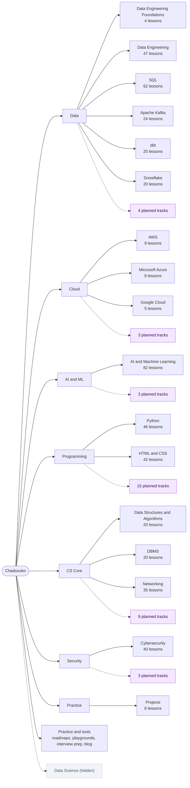

# Chaduvuko site map

> Generated by `scripts/site-inventory.ts` on 2026-11-09. Do not edit by hand: run `npm run build` (or `npx next build`), then `npx tsx scripts/site-inventory.ts`.
> The public version of this map is [/learn/all-courses](https://chaduvuko.com/learn/all-courses). Page-level data is in [SITE_INVENTORY.csv](./SITE_INVENTORY.csv).

## How the site is organised

**Area → Track → Module → Lesson.** An *area* groups related tracks (Data, Cloud, AI & ML, ...). A *track* is a guided course with its own overview page. A *module* is a section inside a track, and a *lesson* is one page with one learning objective.

| What | Count | Where it comes from |
|---|---:|---|
| Published tracks | 16 (+ Projects) | `lib/catalog/tracks.ts` |
| Published lessons | 490 | `lib/catalog` (`LIVE_LESSONS`) |
| Hidden tracks / lessons | 1 / 3 | `hidden` flag in `lib/catalog/tracks.ts` |
| Unpublished (`soon`) lessons | 59 | `data/*-curriculum.ts` |
| Planned tracks (skills maps) | 37 | `data/planned-tracks.ts` |
| Career roadmaps | 20 | `data/roadmaps/role-registry.ts` |
| Blog articles | 31 | `data/blog-articles.ts` |
| Open careers roles | 1 | `data/careers.ts` |

## Map

## Published tracks

| Area | Track | Overview | Modules | Lessons | Avg words / lesson |
|---|---|---|---:|---:|---:|
| Data | Data Engineering Foundations | `/learn/what-is-data-engineering` | 1 | 4 | 1,701 |
| Data | Data Engineering | `/learn/data-engineering` | 6 | 47 | 8,330 |
| Data | SQL | `/learn/sql` | 13 | 62 | 5,952 |
| Data | Apache Kafka | `/learn/apache-kafka` | 5 | 24 | 9,768 |
| Data | dbt | `/learn/dbt` | 4 | 20 | 8,626 |
| Data | Snowflake | `/learn/snowflake` | 5 | 20 | 4,767 |
| Cloud | AWS | `/learn/aws/introduction` | 1 | 9 | 1,207 |
| Cloud | Microsoft Azure | `/learn/azure/introduction` | 1 | 8 | 1,427 |
| Cloud | Google Cloud | `/learn/gcp/introduction` | 1 | 5 | 1,047 |
| AI & ML | AI & Machine Learning | `/learn/ai-ml` | 12 | 82 | 5,673 |
| Programming | Python | `/learn/python` | 6 | 46 | 3,958 |
| Programming | HTML & CSS | `/learn/html-css` | 6 | 42 | 4,326 |
| CS Core | Data Structures & Algorithms | `/learn/dsa` | 1 | 20 | 2,982 |
| CS Core | DBMS | `/learn/dbms` | 5 | 20 | 8,600 |
| CS Core | Networking | `/learn/networking` | 6 | 35 | 6,513 |
| Security | Cybersecurity | `/learn/cybersecurity` | 6 | 40 | 4,915 |
| Practice | Projects | `/learn/projects` | 1 | 6 | 3,577 |

### Modules in each track

<strong>Data Engineering Foundations</strong> — 1 modules

- Overview — 4 lessons

<strong>Data Engineering</strong> — 6 modules

- What Even Is This? — 6 lessons
- Data Fundamentals — 7 lessons
- Core Engineering Skills — 6 lessons
- How Data Moves — 9 lessons
- Storage & Architecture — 7 lessons
- Quality, Governance & Production — 12 lessons

<strong>SQL</strong> — 13 modules

- Databases & Setup — 4 lessons
- Reading Data — SELECT — 10 lessons
- Filtering & Logic — 3 lessons
- Writing & Changing Data — 5 lessons
- Database Design — 4 lessons
- Aggregation — 3 lessons
- Joins — 6 lessons
- Subqueries & Set Operations — 5 lessons
- SQL Functions — 4 lessons
- Advanced SQL Objects — 7 lessons
- Window Functions & CTEs — 5 lessons
- Performance & Optimization — 3 lessons
- Real-World & Interview — 3 lessons

<strong>Apache Kafka</strong> — 5 modules

- Kafka From Zero — 4 lessons
- Core Kafka Mechanics — 5 lessons
- Building Kafka Applications — 5 lessons
- Operations, Security, and Scale — 5 lessons
- Architecture and Real-World Practice — 5 lessons

<strong>dbt</strong> — 4 modules

- dbt Foundations — 5 lessons
- Core dbt Development — 5 lessons
- Intermediate dbt — 5 lessons
- Production and Advanced dbt — 5 lessons

<strong>Snowflake</strong> — 5 modules

- Snowflake Foundations — 4 lessons
- Loading and Transforming Data — 4 lessons
- Snowflake Platform Features — 4 lessons
- Performance, Cost, and Governance — 4 lessons
- Production and Career Readiness — 4 lessons

<strong>AWS</strong> — 1 modules

- Overview — 9 lessons

<strong>Microsoft Azure</strong> — 1 modules

- Overview — 8 lessons

<strong>Google Cloud</strong> — 1 modules

- Overview — 5 lessons

<strong>AI & Machine Learning</strong> — 12 modules

- Introduction — 2 lessons
- Math Foundations — 7 lessons
- Programming Ecosystem — 5 lessons
- Data Engineering for ML — 6 lessons
- Classical Machine Learning — 13 lessons
- Evaluation and Optimisation — 7 lessons
- Deep Learning — 8 lessons
- Natural Language Processing — 6 lessons
- Computer Vision — 5 lessons
- Generative AI — 11 lessons
- MLOps and Production — 7 lessons
- Cloud ML Platforms — 5 lessons

<strong>Python</strong> — 6 modules

- Python Foundations — 10 lessons
- Core Data Structures & Logic — 8 lessons
- Object-Oriented Python — 6 lessons
- Intermediate & Functional Python — 7 lessons
- Advanced Python — 7 lessons
- Production & Career Readiness — 8 lessons

<strong>HTML & CSS</strong> — 6 modules

- HTML Foundations — 10 lessons
- HTML Deep Dive — 6 lessons
- CSS Foundations — 6 lessons
- CSS Layout — 7 lessons
- Advanced CSS — 7 lessons
- Production & Career Readiness — 6 lessons

<strong>Data Structures & Algorithms</strong> — 1 modules

- Overview — 20 lessons

<strong>DBMS</strong> — 5 modules

- Foundations — 4 lessons
- Design & SQL — 4 lessons
- Internals — 4 lessons
- Advanced Theory — 4 lessons
- Distributed & Interview — 4 lessons

<strong>Networking</strong> — 6 modules

- How Networks Work — 6 lessons
- Physical and Data Link Layer — 6 lessons
- The IP Layer — Addressing and Routing — 7 lessons
- Transport Layer — 5 lessons
- Application Layer Protocols — 8 lessons
- Network Security — 3 lessons

<strong>Cybersecurity</strong> — 6 modules

- What Even Is This? — 6 lessons
- How Attacks Work — 7 lessons
- Core Technical Skills — 7 lessons
- Offensive Security — 7 lessons
- Defensive Security — 7 lessons
- Career & Production — 6 lessons

<strong>Projects</strong> — 1 modules

- Overview — 6 lessons

## Hidden content

Hidden tracks stay reachable by direct link but are `noindex`, and are left out of navigation, search, the sitemap, counts, and progress. To restore one, delete its `hidden` field in `lib/catalog/tracks.ts`.

| Track | Overview | Published lessons | Since | Reason |
|---|---|---:|---|---|
| Data Science | `/learn/data-science` | 3 | 2026-11-09 | Only 3 of 53 planned lessons are published; AI & Machine Learning covers the same ground until the track is complete. |

## Planned tracks

Skills maps only; no lessons are published yet. Each page collects learner interest.

| Area | Track | Page | Skills mapped |
|---|---|---|---:|
| Data | Database Engineering | `/learn/track-plan/database-engineering` | 23 |
| Data | Business Intelligence & Analytics | `/learn/track-plan/business-intelligence` | 20 |
| Data | Data Analytics & Analytics Engineering | `/learn/track-plan/analytics-engineering-data-analytics` | 23 |
| Data | Data Governance & Data Quality | `/learn/track-plan/data-governance-engineering` | 23 |
| Cloud | DevOps, Kubernetes & MLOps | `/learn/track-plan/devops-mlops` | 26 |
| Cloud | Site Reliability & Platform Engineering | `/learn/track-plan/sre-platform-engineering` | 24 |
| Cloud | Cloud Architecture & FinOps | `/learn/track-plan/cloud-architecture-finops` | 23 |
| AI & ML | Generative AI & LLM Engineering | `/learn/generative-ai` | 33 |
| AI & ML | Agentic AI & Automation | `/learn/track-plan/agentic-ai` | 26 |
| AI & ML | Applied AI Specializations | `/learn/track-plan/applied-ai-specializations` | 23 |
| Programming | Full-Stack Development with AI | `/learn/track-plan/full-stack-ai` | 29 |
| Programming | JavaScript & TypeScript | `/learn/track-plan/javascript` | 24 |
| Programming | Java & Backend Engineering | `/learn/track-plan/java` | 26 |
| Programming | Systems & Programming Languages | `/learn/track-plan/systems-programming` | 24 |
| Programming | Software Testing & Quality Engineering | `/learn/track-plan/quality-engineering` | 20 |
| Programming | Mobile Development | `/learn/track-plan/mobile-development` | 22 |
| Programming | Accessibility Engineering | `/learn/track-plan/accessibility-engineering` | 21 |
| Programming | Enterprise Platforms & Business Applications | `/learn/track-plan/enterprise-platforms` | 22 |
| Programming | Technical Communication & Developer Relations | `/learn/track-plan/technical-communication-developer-relations` | 21 |
| Programming | Game Development & Computer Graphics | `/learn/track-plan/game-development-graphics` | 23 |
| Programming | Embedded Systems & Internet of Things | `/learn/track-plan/embedded-iot` | 23 |
| Programming | Robotics & Autonomous Systems | `/learn/track-plan/robotics-autonomous-systems` | 22 |
| Programming | Blockchain & Smart Contract Engineering | `/learn/track-plan/blockchain-smart-contracts` | 22 |
| Programming | AR, VR & Spatial Computing | `/learn/track-plan/xr-ar-vr-development` | 21 |
| Programming | Additional Programming Language Pathways | `/learn/track-plan/additional-language-pathways` | 23 |
| CS Core | Mathematics for AI & Engineering | `/learn/track-plan/mathematics` | 21 |
| CS Core | Physics for Computing & Engineering | `/learn/track-plan/physics` | 20 |
| CS Core | System Design & Software Engineering | `/learn/track-plan/system-design` | 24 |
| CS Core | IT Support & Systems Administration | `/learn/track-plan/it-support-systems-administration` | 23 |
| CS Core | Networking & Telecommunications | `/learn/track-plan/networking-telecommunications` | 25 |
| CS Core | Technical Product Management & Business Analysis | `/learn/track-plan/technical-product-business-analysis` | 22 |
| CS Core | Digital Hardware & Semiconductor Design | `/learn/track-plan/semiconductor-digital-hardware` | 22 |
| CS Core | Programming Languages & Compiler Engineering | `/learn/track-plan/programming-languages-compilers` | 21 |
| CS Core | High-Performance & Scientific Computing | `/learn/track-plan/high-performance-scientific-computing` | 22 |
| Security | AI Security & LLM Security | `/learn/track-plan/ai-security` | 26 |
| Security | Application Security & DevSecOps | `/learn/track-plan/application-security-devsecops` | 23 |
| Security | Security Governance, Risk & Privacy | `/learn/track-plan/security-governance-risk-privacy` | 23 |

## Health checks

| Check | Result |
|---|---|
| live lessons not built | 0 — none |
| thin live lessons | 0 — none |
| orphan live lessons | 0 — none |
| unregistered built pages | 2 — `/admin`, `/auth/callback` |
| dead internal links | 0 — none |

Thin = fewer than 400 words in the main content area. Unregistered built pages such as `/admin` and `/auth/callback` are expected.
