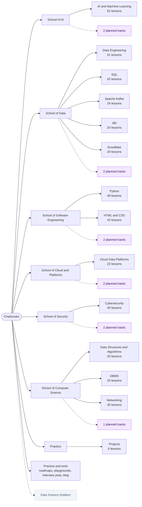

# Chaduvuko site map

> Generated by `scripts/site-inventory.ts` on 2026-11-10. Do not edit by hand: run `npm run build` (or `npx next build`), then `npx tsx scripts/site-inventory.ts`.
> The public version of this map is [/learn/all-courses](https://chaduvuko.com/learn/all-courses). Page-level data is in [SITE_INVENTORY.csv](./SITE_INVENTORY.csv).

## How the site is organised

**School → Track → Module → Lesson.** A *school* groups related tracks (School of AI, School of Data, ...) at `/learn/schools/[slug]`. *Career paths* cut across schools in job order. A *track* is a guided course with its own overview page. A *module* is a section inside a track, and a *lesson* is one page with one learning objective.

| What | Count | Where it comes from |
|---|---:|---|
| Published tracks | 13 (+ Projects) | `lib/catalog/tracks.ts` |
| Published lessons | 490 | `lib/catalog` (`LIVE_LESSONS`) |
| Hidden tracks / lessons | 1 / 3 | `hidden` flag in `lib/catalog/tracks.ts` |
| Unpublished (`soon`) lessons | 59 | `data/*-curriculum.ts` |
| Planned tracks (skills maps) | 11 | `data/planned-tracks.ts` |
| Schools | 6 | `lib/catalog/schools.ts` |
| Career paths | 10 | `data/career-paths.ts` |
| Career roadmaps | 20 | `data/roadmaps/role-registry.ts` |
| Blog articles | 31 | `data/blog-articles.ts` |
| Open careers roles | 1 | `data/careers.ts` |

## Map

## Career paths

Ordered routes across schools, at `/learn/paths/[slug]`. Planned steps link to a skills map until their lessons are published.

| Path | School | Steps | Planned steps | Live lessons |
|---|---|---:|---:|---:|
| [AI Engineer](https://chaduvuko.com/learn/paths/ai-engineer) | School of AI | 7 | 1 | 128 |
| [Agentic AI Engineer](https://chaduvuko.com/learn/paths/agentic-ai-engineer) | School of AI | 6 | 3 | 50 |
| [Machine Learning Engineer](https://chaduvuko.com/learn/paths/ml-engineer) | School of AI | 7 | 1 | 128 |
| [Data Engineer](https://chaduvuko.com/learn/paths/data-engineer) | School of Data | 8 | 0 | 217 |
| [Analytics Engineer & Data Analyst](https://chaduvuko.com/learn/paths/analytics-engineer) | School of Data | 6 | 2 | 120 |
| [Full-Stack Developer (AI-enabled)](https://chaduvuko.com/learn/paths/full-stack-ai-developer) | School of Software Engineering | 6 | 2 | 94 |
| [Cloud & DevOps Engineer](https://chaduvuko.com/learn/paths/cloud-devops-engineer) | School of Cloud & Platforms | 6 | 2 | 70 |
| [Cybersecurity Analyst](https://chaduvuko.com/learn/paths/cybersecurity-analyst) | School of Security | 6 | 1 | 93 |
| [AI Security Engineer](https://chaduvuko.com/learn/paths/ai-security-engineer) | School of Security | 5 | 2 | 68 |
| [Software Engineer (interview-ready)](https://chaduvuko.com/learn/paths/software-engineer) | School of Computer Science | 6 | 1 | 147 |

## Published tracks

| School | Track | Overview | Modules | Lessons | Avg words / lesson |
|---|---|---|---:|---:|---:|
| School of AI | AI & Machine Learning | `/learn/ai-ml` | 12 | 82 | 0 |
| School of Data | Data Engineering | `/learn/data-engineering` | 7 | 51 | 0 |
| School of Data | SQL | `/learn/sql` | 13 | 62 | 0 |
| School of Data | Apache Kafka | `/learn/apache-kafka` | 5 | 24 | 0 |
| School of Data | dbt | `/learn/dbt` | 4 | 20 | 0 |
| School of Data | Snowflake | `/learn/snowflake` | 5 | 20 | 0 |
| School of Software Engineering | Python | `/learn/python` | 6 | 46 | 0 |
| School of Software Engineering | HTML & CSS | `/learn/html-css` | 6 | 42 | 0 |
| School of Cloud & Platforms | Cloud Data Platforms | `/learn/cloud-data` | 3 | 22 | 0 |
| School of Security | Cybersecurity | `/learn/cybersecurity` | 6 | 40 | 0 |
| School of Computer Science | Data Structures & Algorithms | `/learn/dsa` | 1 | 20 | 0 |
| School of Computer Science | DBMS | `/learn/dbms` | 5 | 20 | 0 |
| School of Computer Science | Networking | `/learn/networking` | 6 | 35 | 0 |
| Practice | Projects | `/learn/projects` | 1 | 6 | 0 |

### Modules in each track

<strong>AI & Machine Learning</strong> — 12 modules

- Introduction — 2 lessons
- Math Foundations — 7 lessons
- Programming Ecosystem — 5 lessons
- Data Engineering for ML — 6 lessons
- Classical Machine Learning — 13 lessons
- Evaluation and Optimisation — 7 lessons
- Deep Learning — 8 lessons
- Natural Language Processing — 6 lessons
- Computer Vision — 5 lessons
- Generative AI — 11 lessons
- MLOps and Production — 7 lessons
- Cloud ML Platforms — 5 lessons

<strong>Data Engineering</strong> — 7 modules

- Data Engineering Foundations — 4 lessons
- What Even Is This? — 6 lessons
- Data Fundamentals — 7 lessons
- Core Engineering Skills — 6 lessons
- How Data Moves — 9 lessons
- Storage & Architecture — 7 lessons
- Quality, Governance & Production — 12 lessons

<strong>SQL</strong> — 13 modules

- Databases & Setup — 4 lessons
- Reading Data — SELECT — 10 lessons
- Filtering & Logic — 3 lessons
- Writing & Changing Data — 5 lessons
- Database Design — 4 lessons
- Aggregation — 3 lessons
- Joins — 6 lessons
- Subqueries & Set Operations — 5 lessons
- SQL Functions — 4 lessons
- Advanced SQL Objects — 7 lessons
- Window Functions & CTEs — 5 lessons
- Performance & Optimization — 3 lessons
- Real-World & Interview — 3 lessons

<strong>Apache Kafka</strong> — 5 modules

- Kafka From Zero — 4 lessons
- Core Kafka Mechanics — 5 lessons
- Building Kafka Applications — 5 lessons
- Operations, Security, and Scale — 5 lessons
- Architecture and Real-World Practice — 5 lessons

<strong>dbt</strong> — 4 modules

- dbt Foundations — 5 lessons
- Core dbt Development — 5 lessons
- Intermediate dbt — 5 lessons
- Production and Advanced dbt — 5 lessons

<strong>Snowflake</strong> — 5 modules

- Snowflake Foundations — 4 lessons
- Loading and Transforming Data — 4 lessons
- Snowflake Platform Features — 4 lessons
- Performance, Cost, and Governance — 4 lessons
- Production and Career Readiness — 4 lessons

<strong>Python</strong> — 6 modules

- Python Foundations — 10 lessons
- Core Data Structures & Logic — 8 lessons
- Object-Oriented Python — 6 lessons
- Intermediate & Functional Python — 7 lessons
- Advanced Python — 7 lessons
- Production & Career Readiness — 8 lessons

<strong>HTML & CSS</strong> — 6 modules

- HTML Foundations — 10 lessons
- HTML Deep Dive — 6 lessons
- CSS Foundations — 6 lessons
- CSS Layout — 7 lessons
- Advanced CSS — 7 lessons
- Production & Career Readiness — 6 lessons

<strong>Cloud Data Platforms</strong> — 3 modules

- AWS — 9 lessons
- Microsoft Azure — 8 lessons
- Google Cloud — 5 lessons

<strong>Cybersecurity</strong> — 6 modules

- What Even Is This? — 6 lessons
- How Attacks Work — 7 lessons
- Core Technical Skills — 7 lessons
- Offensive Security — 7 lessons
- Defensive Security — 7 lessons
- Career & Production — 6 lessons

<strong>Data Structures & Algorithms</strong> — 1 modules

- Overview — 20 lessons

<strong>DBMS</strong> — 5 modules

- Foundations — 4 lessons
- Design & SQL — 4 lessons
- Internals — 4 lessons
- Advanced Theory — 4 lessons
- Distributed & Interview — 4 lessons

<strong>Networking</strong> — 6 modules

- How Networks Work — 6 lessons
- Physical and Data Link Layer — 6 lessons
- The IP Layer — Addressing and Routing — 7 lessons
- Transport Layer — 5 lessons
- Application Layer Protocols — 8 lessons
- Network Security — 3 lessons

<strong>Projects</strong> — 1 modules

- Overview — 6 lessons

## Hidden content

Hidden tracks stay reachable by direct link but are `noindex`, and are left out of navigation, search, the sitemap, counts, and progress. To restore one, delete its `hidden` field in `lib/catalog/tracks.ts`.

| Track | Overview | Published lessons | Since | Reason |
|---|---|---:|---|---|
| Data Science | `/learn/data-science` | 3 | 2026-11-09 | Only 3 of 53 planned lessons are published; AI & Machine Learning covers the same ground until the track is complete. |

## Planned tracks

Skills maps only; no lessons are published yet. Each page collects learner interest.

| School | Track | Page | Skills mapped |
|---|---|---|---:|
| School of AI | Generative AI & LLM Engineering | `/learn/generative-ai` | 33 |
| School of AI | Agentic AI & Automation | `/learn/track-plan/agentic-ai` | 26 |
| School of Data | Business Intelligence & Analytics | `/learn/track-plan/business-intelligence` | 20 |
| School of Data | Data Analytics & Analytics Engineering | `/learn/track-plan/analytics-engineering-data-analytics` | 23 |
| School of Software Engineering | Full-Stack Development with AI | `/learn/track-plan/full-stack-ai` | 29 |
| School of Software Engineering | JavaScript & TypeScript | `/learn/track-plan/javascript` | 24 |
| School of Cloud & Platforms | DevOps, Kubernetes & MLOps | `/learn/track-plan/devops-mlops` | 26 |
| School of Cloud & Platforms | Site Reliability & Platform Engineering | `/learn/track-plan/sre-platform-engineering` | 24 |
| School of Security | AI Security & LLM Security | `/learn/track-plan/ai-security` | 26 |
| School of Security | Application Security & DevSecOps | `/learn/track-plan/application-security-devsecops` | 23 |
| School of Computer Science | System Design & Software Engineering | `/learn/track-plan/system-design` | 24 |

## Health checks

| Check | Result |
|---|---|
| live lessons not built | 490 — `/learn/ai-ml/what-is-ai`, `/learn/ai-ml/ai-ml-landscape`, `/learn/ai-ml/math-foundations/vectors-matrices-tensors`, `/learn/ai-ml/math-foundations/matrix-multiplication`, `/learn/ai-ml/math-foundations/dot-product-similarity`, `/learn/ai-ml/math-foundations/eigenvalues-eigenvectors`, `/learn/ai-ml/math-foundations/derivatives-and-gradients`, `/learn/ai-ml/math-foundations/probability-distributions`, and 482 more |
| thin live lessons | 0 — none |
| orphan live lessons | 490 — `/learn/ai-ml/what-is-ai`, `/learn/ai-ml/ai-ml-landscape`, `/learn/ai-ml/math-foundations/vectors-matrices-tensors`, `/learn/ai-ml/math-foundations/matrix-multiplication`, `/learn/ai-ml/math-foundations/dot-product-similarity`, `/learn/ai-ml/math-foundations/eigenvalues-eigenvectors`, `/learn/ai-ml/math-foundations/derivatives-and-gradients`, `/learn/ai-ml/math-foundations/probability-distributions`, and 482 more |
| unregistered built pages | 0 — none |
| dead internal links | 0 — none |

Thin = fewer than 400 words in the main content area. Unregistered built pages such as `/admin` and `/auth/callback` are expected.
